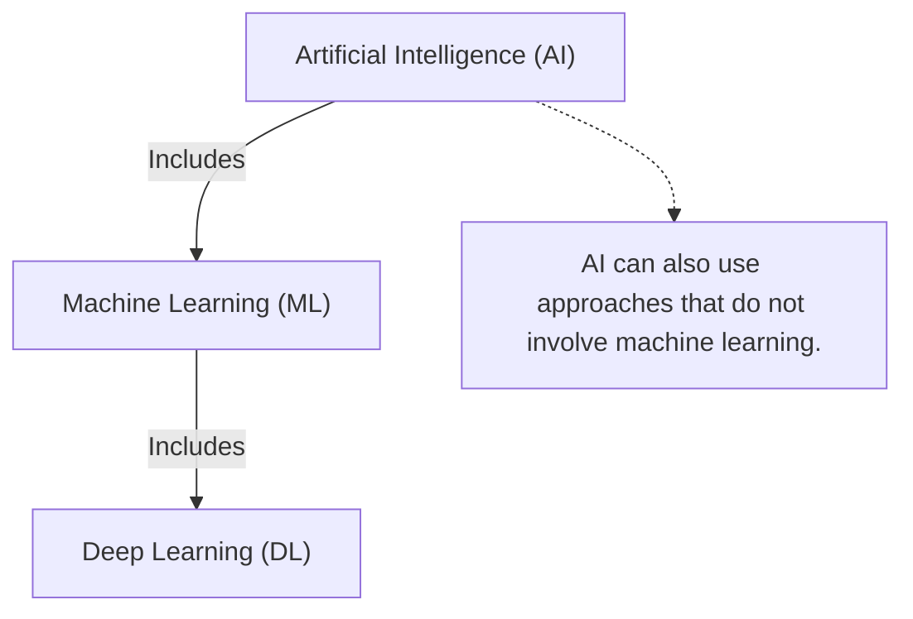

# Chapter 1: What Is Artificial Intelligence?

**Level:** Beginner  
**Estimated learning time:** 35–45 minutes  
**Target audience:** Students and general learners with little or no prior knowledge of AI

## 1. Chapter Overview

Artificial Intelligence (AI) is a field of computer science that focuses on creating systems capable of performing tasks associated with human intelligence. These tasks include learning, reasoning, problem-solving, recognising patterns, understanding language, and making predictions.

AI is used in education, healthcare, business, transportation, communication, and everyday digital tools.

There are different approaches to developing AI systems. Three important approaches are Symbolic AI, Connectionist AI, and Behavior-Based AI. Each approach represents a different way of creating intelligent behaviour.

This chapter introduces the meaning of AI, its development, common applications, and these three approaches.

## 2. Learning Objectives

By the end of this chapter, learners should be able to:

- Define artificial intelligence in their own words.
- Identify common examples of AI in everyday life.
- Explain the basic development of AI.
- Describe Symbolic, Connectionist, and Behavior-Based AI.
- Compare the strengths and limitations of these approaches.
- Distinguish AI, machine learning, and deep learning.
- Identify common benefits and limitations of AI.

## 3. What Is Artificial Intelligence?

Artificial Intelligence refers to computer systems designed to perform tasks associated with human intelligence.

Examples include:

- Recognising faces in photographs.
- Translating languages.
- Recommending movies or music.
- Answering questions using chatbots.
- Detecting suspicious banking transactions.
- Supporting medical image analysis.

AI systems do not all work in the same way. Some follow programmed rules, some learn patterns from data, and others learn through interaction with an environment.

## 4. A Brief History of AI

AI has developed through several important stages:

- **1950:** Alan Turing published his paper "Computing Machinery and Intelligence," introducing the question of whether machines can think.
- **1956:** The Dartmouth Summer Research Project on Artificial Intelligence helped establish AI as a formal research field.
- **1960s–1970s:** Researchers developed symbolic reasoning systems and early problem-solving programs.
- **1980s:** Expert systems became more widely used in specialised areas.
- **1990s–2000s:** Machine learning developed further as datasets and computing capabilities improved.
- **2010s:** Deep learning advanced image recognition, speech recognition, and natural language processing.
- **2020s:** Generative AI tools became widely available for producing text, images, audio, and other content.
## 5. Three Main Approaches to Artificial Intelligence

### 5.1 Symbolic AI

Symbolic AI uses symbols, facts, logical rules, and structured knowledge to represent information and solve problems.

Instead of learning everything from examples, a symbolic system follows rules provided by humans or encoded in its knowledge base.

**How it works:**

1. Information is represented using symbols or facts.
2. Rules describe relationships between the facts.
3. A reasoning system applies these rules to reach a conclusion.

**Examples:**

- Expert systems that support medical decision-making.
- Rule-based chatbots.
- Systems that solve logical puzzles.
- Planning systems that follow defined conditions.

**Strengths:**

- Rules and reasoning processes can be easier to explain.
- Works well when information and rules are clearly defined.
- Can produce predictable results in structured situations.

**Limitations:**

- Requires humans to define many rules.
- Can struggle with uncertain or incomplete information.
- May not adapt easily to unexpected situations.

### 5.2 Connectionist AI

Connectionist AI is inspired by the way networks of neurons process information. It uses artificial neural networks made up of connected computational units.

These systems learn patterns from data by adjusting the strengths of connections between units during training.

**How it works:**

1. The system receives training data.
2. Information passes through connected artificial neurons.
3. The network produces an output.
4. The system compares the output with the expected result.
5. Its internal parameters are adjusted to improve future results.

**Examples:**

- Image recognition.
- Speech recognition.
- Language translation.
- Deep learning systems.
- Generative AI models.

**Strengths:**

- Can learn complex patterns from large datasets.
- Useful for images, audio, text, and other complex information.
- Can improve through training.

**Limitations:**

- Often requires large amounts of data and computing resources.
- Decisions can be difficult to explain.
- May learn biases or errors present in training data.

### 5.3 Behavior-Based AI

Behavior-Based AI focuses on creating intelligent behaviour through interactions between a system and its environment. It is commonly used in robotics, where systems respond to changes in their surroundings.

A related learning method is Reinforcement Learning. It allows an agent to improve its decisions by taking actions and receiving rewards or penalties from its environment.

**How Behavior-Based AI works:**

1. The system observes its environment.
2. It identifies changes or conditions around it.
3. It responds using programmed behaviours.
4. It adjusts its response when the environment changes.

**How Reinforcement Learning works:**

1. An agent observes its environment.
2. It chooses an action.
3. The environment responds.
4. The agent receives a reward or penalty.
5. It uses this feedback to improve future decisions.

**Examples:**

- Robots that avoid obstacles using sensor information.
- Robots that respond to nearby objects or movement.
- Game-playing AI that improves its strategy through rewards.
- AI agents that learn decisions through repeated interaction.

**Strengths:**

- Can respond to changes in the environment.
- Useful for robotics and interactive systems.
- Reinforcement Learning can improve decisions through feedback.

**Limitations:**

- May struggle in unfamiliar environments.
- Can require repeated interaction and feedback.
- Performance depends on the quality of environmental information and feedback.
  
### 5.4 Comparing the Three Approaches

| Approach | Main Idea | How It Works | Example |
|---|---|---|---|
| Symbolic AI | Rules and logic | Uses human-defined knowledge and logical rules | Expert systems |
| Connectionist AI | Neural networks | Learns patterns from data | Image recognition |
| Behavior-Based AI | Interaction with the environment | Responds to environmental changes through behaviours | Robots that avoid obstacles |

Reinforcement Learning is a related learning method in which an agent improves its decisions through actions and feedback. It is commonly used in game-playing AI and robotics.

These approaches are not always completely separate. Modern AI systems can combine ideas from different approaches.

## 6. AI, Machine Learning, and Deep Learning

AI, machine learning, and deep learning are related concepts, but they do not mean exactly the same thing.

- **Artificial Intelligence (AI):** The broad field of creating systems that perform tasks associated with intelligence.
- **Machine Learning (ML):** A branch of AI that allows systems to learn patterns from data.
- **Deep Learning (DL):** A branch of machine learning that uses multi-layer neural networks.

Their relationship can be represented as:

**AI → Machine Learning → Deep Learning**

All deep learning is machine learning, and all machine learning is part of AI. However, not all AI uses machine learning.

## 7. AI in Everyday Life

| Area | Example | Purpose |
|---|---|---|
| Education | AI learning assistants | Support learning and provide explanations |
| Healthcare | Medical image analysis | Help identify patterns in medical images |
| Entertainment | Movie recommendations | Suggest content based on preferences |
| Transportation | Navigation systems | Estimate routes and travel times |
| Business | Customer service chatbots | Respond to common customer questions |
| Communication | Translation tools | Translate text between languages |

AI can make services more efficient, but its outputs still need to be evaluated.

## 8. Benefits and Limitations of AI

### Benefits

- **Efficiency:** AI can complete certain tasks quickly.
- **Pattern recognition:** AI can identify patterns in large amounts of data.
- **Accessibility:** AI tools can support translation and communication.
- **Automation:** Repetitive tasks can be handled automatically.
- **Decision support:** AI can provide information that helps people make decisions.

### Limitations

- **Errors:** AI systems can produce incorrect information.
- **Bias:** Systems may reflect unfair patterns in their training data.
- **Privacy:** AI tools may process personal or sensitive information.
- **Lack of human judgement:** AI does not replace human understanding and responsibility.
- **Dependence on data:** Poor-quality data can lead to unreliable results.

## 9. Practical Activity: Identify the AI Approach

Read each scenario and identify the AI approach that best matches it.

1. A computer program uses a set of medical rules to suggest possible conditions.
2. A neural network learns to recognise cats and dogs from thousands of labelled pictures.
3. A game-playing agent improves its strategy by receiving rewards when it wins.

**Questions:**

- Which approach is used in each scenario?
- What is the main difference between the three approaches?
- What might be one limitation of each system?

**Suggested Answers:**

1. Symbolic AI — the system uses predefined medical rules and knowledge.
2. Connectionist AI — the neural network learns patterns from labelled pictures.
3. Reinforcement Learning — the agent improves its strategy through actions and rewards.

**Key Explanation:**

Behavior-Based AI and Reinforcement Learning are related but not identical. Behavior-Based AI focuses on responding to the environment, while Reinforcement Learning focuses on improving actions through rewards and feedback.

## 10. Knowledge Check

**1. What is artificial intelligence?**

A. A computer that only stores information.  
B. A field of computing that develops systems capable of performing tasks associated with intelligence.  
C. A programming language.  
D. A type of computer hardware.

**Answer: B.** AI focuses on developing systems that can perform tasks such as learning, reasoning, and problem-solving.

**2. Which approach uses logical rules and symbols?**

A. Behavior-Based AI
B. Connectionist AI  
C. Symbolic AI  
D. Deep learning

**Answer: C.** Symbolic AI represents knowledge using symbols, facts, and logical rules.

**3. Which approach uses artificial neural networks?**

A. Symbolic AI  
B. Connectionist AI  
C. Behavior-Based AI
D. Rule-based computing

**Answer: B.** Connectionist AI uses networks of connected computational units to learn patterns.

**4. Which statement best describes Behavior-Based AI?**

A. It responds to changes in the environment using different behaviours.  
B. It only follows fixed mathematical equations.  
C. It stores information without processing it.  
D. It only uses predefined logical rules.

**Answer: A.** Behavior-Based AI focuses on how a system responds to changes in its environment. Reinforcement Learning is a related method that uses rewards and feedback to improve decisions.

**5. Which statement about deep learning is correct?**

A. It is separate from AI.  
B. It is a type of symbolic reasoning.  
C. It is a branch of machine learning that uses multi-layer neural networks.  
D. It only works with text.

**Answer: C.** Deep learning uses neural networks with multiple layers to learn complex patterns.

## 11. Chapter Summary

Artificial Intelligence is a field of computing that develops systems capable of performing tasks associated with human intelligence.

This chapter introduced three important AI approaches:

- Symbolic AI uses symbols, facts, and logical rules.
- Connectionist AI uses neural networks to learn patterns from data.
- Behavior-Based AI responds to changes in its environment, while Reinforcement Learning uses rewards and feedback to improve decisions.

We also explored the relationship between AI, machine learning, and deep learning, along with everyday applications, benefits, and limitations.

## 12. Key Terms

| Term | Definition |
|---|---|
| Artificial Intelligence | The field of creating systems that perform tasks associated with intelligence. |
| Symbolic AI | An approach that uses symbols, facts, and logical rules. |
| Connectionist AI | An approach based on connected computational units, such as neural networks. |
| Behavior-Based AI | An approach in which systems respond to changes in their environment. |
| Machine Learning | A branch of AI that learns patterns from data. |
| Deep Learning | A branch of machine learning that uses multi-layer neural networks. |
| Neural Network | A computational model made up of connected processing units. |
| Reinforcement Learning | A learning approach based on actions, rewards, and feedback. |

## 13. References and Further Reading

- Russell, S. and Norvig, P. *Artificial Intelligence: A Modern Approach*. Pearson.
- Turing, A. M. (1950). Computing Machinery and Intelligence. *Mind*, 59(236), 433–460.
- Dartmouth College. [Artificial Intelligence Coined at Dartmouth](https://home.dartmouth.edu/about/artificial-intelligence-ai-coined-dartmouth).
- IBM. [What is Artificial Intelligence (AI)?](https://www.ibm.com/think/topics/artificial-intelligence)
- IBM. [What is Machine Learning?](https://www.ibm.com/think/topics/machine-learning)
- Google for Developers. [Introduction to Machine Learning](https://developers.google.com/machine-learning/intro-to-ml)

## 14. Chapter Completion Checklist

- [x] AI is clearly defined.
- [x] A brief history of AI is included.
- [x] Symbolic AI is explained with examples, strengths, and limitations.
- [x] Connectionist AI is explained with examples, strengths, and limitations.
- [x] Behavior-Based AI is explained with examples, strengths, and limitations.
- [x] The three approaches are compared.
- [x] The relationship between AI, ML, and DL is explained.
- [x] Everyday applications are included.
- [x] Benefits and limitations are discussed.
- [x] Practical activity and suggested answers are included.
- [x] Knowledge-check answers include explanations.
- [ ] References and links have been checked.
- [ ] Markdown formatting has been reviewed.

### Visual Diagram: Relationship Between AI, ML, and DL

